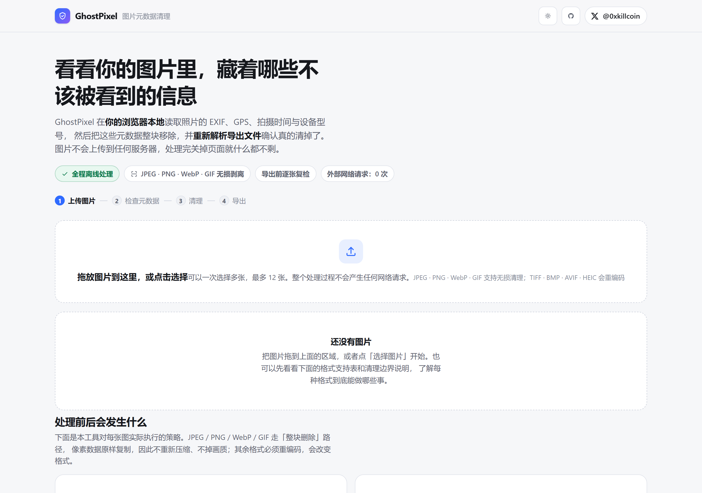
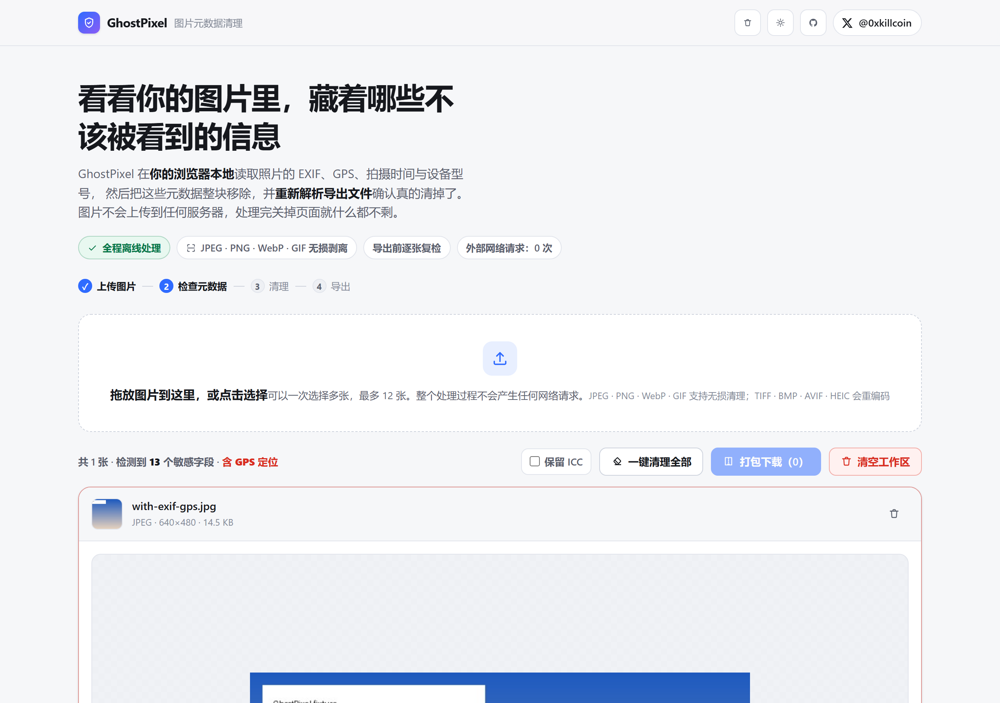
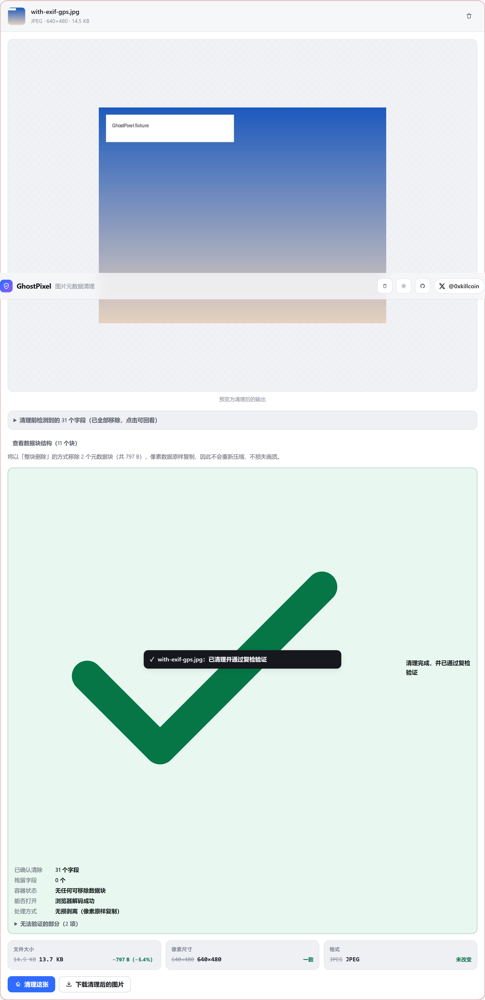
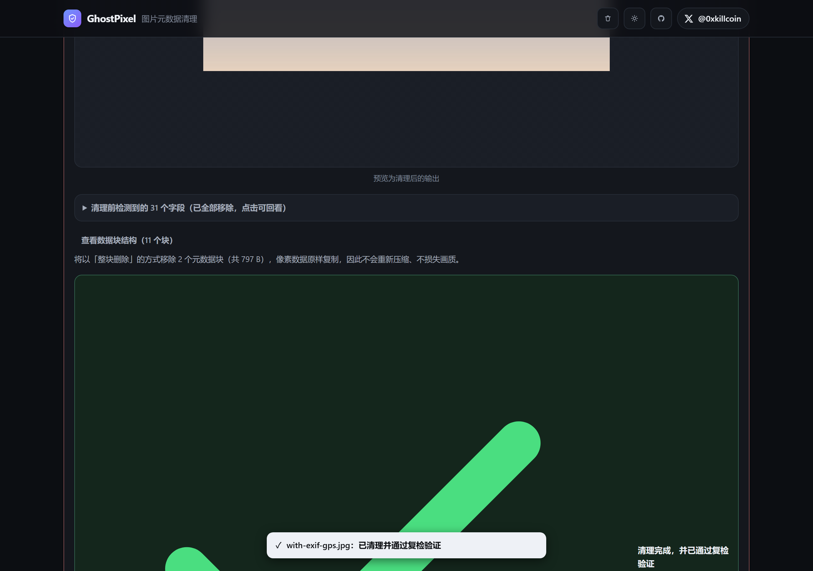
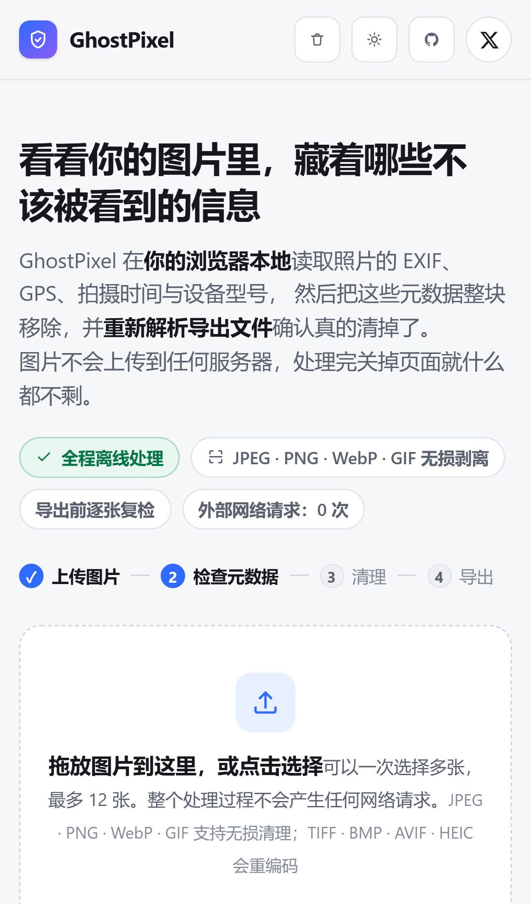

<div align="center">

# 👻 GhostPixel

**浏览器端的图片元数据检查与清理工具 —— 图片永不上传。**

看看你的照片里藏着哪些不该被看到的信息，然后把这些信息**整块**移除，并**重新解析**确认真的清掉了。

<a href="https://x.com/0xkillcoin"></a>


[**在线体验**](https://iiiiiiiiiiiiiKK.github.io/ghostpixel/) · [支持格式](#-支持格式与清理能力) · [清理边界](#-为什么不能宣称清除所有隐藏信息) · [本地运行](#-本地开发)

</div>

---

## 📸 截图

真实界面截图，全部由 `scripts/shoot.mjs` 从实际运行的构建产物中自动抓取（非示意图）。

| 空状态 | 检测到元数据（含 GPS） |
| :---: | :---: |
|  |  |

| 清理完成 + 复检验证 + 前后对比 |
| :---: |
|  |

| 深色模式 | iPhone 尺寸 |
| :---: | :---: |
|  |  |

---

## 💡 它解决什么问题

你在微信群、闲鱼、小红书、X 上发一张照片，照片里可能带着：

- 📍 **GPS 坐标** —— 精确到米，直接暴露你家、公司、孩子的学校
- 📷 **设备型号与序列号** —— 把你在不同账号下的照片串成同一个人
- 🕐 **拍摄时间** —— 精确到秒，能还原你的作息规律
- 👤 **作者 / 版权 / 备注** —— 有时是你的真名或内部备注
- 🖥️ **处理软件 / 设备名** —— 暴露出你用的电脑用户名之类的东西

大多数平台**不会**在展示时帮你删掉这些，只是不显示而已。文件本身还是带着它们。

GhostPixel 做的事很简单：**在你自己的浏览器里**把图片撕开、看一看里面有什么、把元数据整块挖掉、再把结果重新读一遍确认干净、最后交给你下载。

> 用完关掉页面，内存里什么都不剩。没有上传，没有账号，没有云端，没有埋点。

---

## ✨ 功能清单

| | 功能 | 说明 |
| :---: | :--- | :--- |
| ✅ | **拖放 / 选择上传** | 支持一次多张（默认上限 12 张），带进度状态 |
| ✅ | **实时预览** | 真实图片预览，棋盘格背景便于看出透明通道 |
| ✅ | **尺寸 / 格式 / 大小** | 从文件头直接读取，不依赖文件名后缀 |
| ✅ | **结构化元数据检测** | EXIF / GPS / XMP / IPTC / PNG 文本块 / 容器私有块 |
| ✅ | **按类别分组展示** | 位置 · 设备 · 拍摄参数 · 软件 · 内容署名 · 内嵌资源 |
| ✅ | **敏感度标记** | 高敏感字段红色高亮 + 逐条说明「为什么危险」 |
| ✅ | **GPS 定位提示** | 单独红色警告条，显示坐标 |
| ✅ | **数据块结构可视化** | 逐块列出「将移除 / 保留」及原因，可展开查看 |
| ✅ | **一键清理** | 单张或批量，`Ctrl/Cmd + Shift + C` 快捷键 |
| ✅ | **清理后复检验证** | 重新解析 + 重新解码，字段残留则不提供下载 |
| ✅ | **前后对比** | 文件大小 / 像素尺寸 / 格式三项对比 + 变化百分比 |
| ✅ | **单张下载** | `原名.cleaned.扩展名` |
| ✅ | **批量 ZIP 打包** | 附赠自动生成的 `清理报告.txt` |
| ✅ | **一键清空工作区** | 同时释放所有 ObjectURL，避免内存泄漏 |
| ✅ | **深色模式** | 跟随系统 + 手动三态切换（系统 / 浅色 / 深色） |
| ✅ | **移动端自适应** | 320px 起无横向溢出，触控目标 ≥ 32px |
| ✅ | **键盘可操作** | 全流程 Tab 可达，Enter/Space 触发上传区 |
| ✅ | **保留 ICC 选项** | 需要更准的颜色时可选择留下色彩配置 |

---

## 🧬 支持格式与清理能力

不同格式的元数据存放在**完全不同的结构**里，所以「能做到什么」必须逐格式说明。下表是**实际实现的行为**，不是营销描述。

| 格式 | 可读取的元数据 | 清理方式 | 路径 | 边界说明 |
| :--- | :--- | :--- | :---: | :--- |
| **JPEG**<br>`.jpg .jpeg` | EXIF · GPS · XMP · IPTC · ICC · 注释 | 整段移除 APP1 / APP13 / APP15 / COM | 🟢 无损剥离 | 保留 JFIF(APP0)、Adobe(APP14)、量化表、霍夫曼表——它们是解码必需，不含拍摄信息 |
| **PNG**<br>`.png` | tEXt · zTXt · iTXt · eXIf · tIME · iCCP | 移除全部文本块、eXIf、时间块、未知辅助块、IEND 后附加数据 | 🟢 无损剥离 | IHDR / PLTE / IDAT / tRNS 保持不变，透明通道不受影响 |
| **WebP**<br>`.webp` | EXIF · XMP · ICCP 块 | 移除 EXIF / XMP / ICCP，**同步修正 VP8X 标志位与 RIFF 长度** | 🟢 无损剥离 | 不修 VP8X 特定位会导致解码器去找已删除的块而报错 |
| **GIF**<br>`.gif` | 注释扩展 · 应用扩展（含 XMP）· 纯文本扩展 | 移除注释、应用扩展、纯文本扩展块 | 🟢 无损剥离 | 帧数据、调色板、图形控制扩展不变，动画时序不受影响 |
| **TIFF**<br>`.tif .tiff` | 完整 EXIF（TIFF 就是 EXIF 的母体） | Canvas 重编码为 PNG | 🟡 重新编码 | **格式会改变**，位深可能被规范化为 8 位；不保证保留多页 TIFF |
| **BMP**<br>`.bmp` | 通常无元数据 | Canvas 重编码为 PNG | 🟡 重新编码 | **格式改变**；像素本身通常不含隐私信息 |
| **AVIF**<br>`.avif` | 仅容器层可见性 | Canvas 重编码为 PNG | 🟡 重新编码 | 依赖浏览器解码；不保证 HDR 与色彩信息完全保留 |
| **HEIC**<br>`.heic .heif` | 仅当浏览器能解码时 | Canvas 重编码为 PNG | 🟡 重新编码 | Chrome / Firefox 多数版本无法解码，此时**明确报错**而不是假装成功 |

### 为什么优先「无损剥离」而不是全用 Canvas 重编码

很多同类工具直接 `canvas.toBlob()` 一把梭。这个做法有三个真实代价，我们不想让用户默默承担：

1. **会重新压缩** → 有损格式（JPEG / WebP lossy）画质一定下降
2. **会改格式** → TIFF 变 PNG、HEIC 变 PNG，用户拿到的东西和预期不符
3. **会丢透明通道** → 转 JPEG 时透明区被填成白色
4. **更重要的是：它并不能保证更干净** → Canvas 编码器自己也可能写入私有块

所以我们以**字节级容器重写**为主路径：精确找到元数据块，整块删除，像素数据原样复制。只有结构复杂到无法安全重写的格式（TIFF 的 IFD 树、AVIF 的 ISOBMFF item）才退回 Canvas，并在界面上**明确标注**会发生什么变化。

---

## 🔬 为什么不能宣称「清除所有隐藏信息」

这句话我们写在 README 里，也写在产品页面最显眼的位置：

> **任何声称 100% 清除的工具，都在某个它没考虑到的地方说了谎。**

产品里严格区分三种状态：

| 状态 | 含义 | 如何得出 |
| :--- | :--- | :--- |
| 🟢 **已检测** | 容器结构中被识别出的每个块、解析器能展开的每个字段 | 字节级扫描 + exifr 解析，逐条列在表格里 |
| ✅ **已清理** | 导出文件被**重新解析**后该字段确实不再出现 | 重新跑一遍完整解析流程，集合取差集 |
| ⚠️ **无法验证** | 像素级隐写、未公开私有块内部、平台二次写入 | 我们只能说「不在本次验证范围内」 |

**不会**出现的表述：~~"已彻底清除所有隐藏信息"~~、~~"100% 安全"~~、~~"军工级擦除"~~。

### 已知限制

- **像素级隐写**：把数据编码进像素最低有效位（LSB）的做法无法通过元数据清理去除，本工具也不做隐写检测。需要彻底排除时只能重编码 + 有损压缩，或重新拍摄。
- **未解析的私有块**：某些设备的 MakerNote 内部结构不公开。本工具会把**整个块**移除，但无法逐一列出其中字段。
- **已被裁剪的字段**：如果你先用其他软件删了 EXIF，本工具看不到「曾经有过什么」，只能报告当前状态。
- **平台二次写入**：图片上传到社交平台或云盘后，对方可能重新写入自己的元数据。这一步不在本工具控制范围内。
- **重编码路径的差异**：TIFF / BMP / AVIF / HEIC 会经 Canvas 重编码为 PNG，格式一定改变，透明通道与色彩位深可能有规范化差异。
- **超大文件**：超过约 40 兆像素（约 40MP）的图片会被拒绝深度处理，以避免标签页崩溃。
- **损坏文件**：会被标记为「结构可能已损坏」，清理后若无法重新解码则**拒绝提供下载**，而不是给你一个坏文件。

---

## 🛡 隐私与安全

这些都是可以在 DevTools 的 **Network 面板**里自己验证的行为，不是宣传语。

| 承诺 | 实现方式 | 怎么自己验证 |
| :--- | :--- | :--- |
| **不上传、不联网** | 无任何 `fetch` / `XHR` / WebSocket / `sendBeacon` 指向外部 | 断开网络后使用，功能完全一样 |
| **不写入持久存储** | 图片只在内存与临时 ObjectURL 中 | 检查 Application → Storage，全程为空 |
| **不接入分析脚本** | 无 GA、无像素追踪、无第三方字体 CDN | 看构建产物，只有本仓库自己的代码 |
| **输出必须被验证** | 每个导出文件重新读回、重新解析、重新解码 | UI 里直接显示「残留字段：0 个」「无任何可移除数据块」 |
| **及时释放资源** | 卸载 / 清空时 `revokeObjectURL`，下载后 1~1.5s 释放 | Performance Monitor 里内存不会持续增长 |

**关于「资源消耗限制」**：单文件 40MB / 40MP 上限、单批次 12 张上限、PNG chunk 解析 10 万块守卫、元数据深度解析 64MB 上限、递归深度 6 层限制。这些不是为了让功能看起来简单，是为了恶意构造的图片不会把你的浏览器卡死。

---

## 🚀 在线体验

👉 **<https://iiiiiiiiiiiiiKK.github.io/ghostpixel/>**

纯静态站，部署在 GitHub Pages 上，没有任何后端。

---

## 🏗 技术栈与架构

```
TypeScript 5.9 · React 19 · Vite 7 · exifr 7 · fflate 0.8
测试：Vitest 5（单元） + Playwright（E2E，桌面 + iPhone 视口）
部署：GitHub Pages（静态） + GitHub Actions CI
```

### 数据流

```
用户拖入图片
      │
      ▼
┌─────────────────────────────┐
│ 1. 格式识别（魔数，不看后缀） │  detectFormat()
└─────────────┬───────────────┘
              ▼
┌─────────────────────────────────────────────────┐
│ 2. 容器层扫描（字节级）                          │  scanContainer()
│    JPEG: APP0..APP15 / COM / DQT / SOF / SCAN   │
│    PNG:  逐 chunk 遍历 + IEND 后附加数据检测      │
│    WebP: RIFF chunk 遍历 + VP8X 标志位读取       │
│    GIF:  扩展块 / 图像块遍历                     │
└─────────────┬───────────────────────────────────┘
              ▼
┌─────────────────────────────────────────────────┐
│ 3. 结构化字段解析                                │  parseMetadata()
│    JPEG/TIFF/AVIF: exifr（EXIF/GPS/XMP/IPTC）   │
│    PNG: 自研 tEXt/zTXt/iTXt 解析 + exifr(eXIf)  │
│    WebP: exifr + XMP 明文标记扫描               │
└─────────────┬───────────────────────────────────┘
              ▼
┌─────────────────────────────────────────────────┐
│ 4. 分组 + 敏感度标注                             │  buildMetadataReport()
│    路径作唯一 key，便于清理前后做集合比较         │
└─────────────┬───────────────────────────────────┘
              ▼
       ┌──────┴───────┐
       │ 无损可用？    │
       └──────┬───────┘
        是 ↙         ↘ 否
┌──────────────────┐  ┌────────────────────────┐
│ 5a. 容器重写      │  │ 5b. Canvas 重编码 → PNG │
│ stripContainer() │  │ transcode()            │
│ 像素字节原样复制   │  │ 明确告知格式/透明变化     │
└────────┬─────────┘  └───────────┬────────────┘
         └──────────┬─────────────┘
                    ▼
┌─────────────────────────────────────────────────┐
│ 6. 复检验证（关键一步）                          │  verify()
│    a. 重新 scanContainer → 还有可移除块吗？      │
│    b. 重新 parseMetadata → 字段集合差集          │
│    c. createImageBitmap → 真的能解码吗？         │
│    d. 尺寸/格式是否一致？                        │
│    任一失败 → ok:false → 不提供下载               │
└─────────────┬───────────────────────────────────┘
              ▼
        下载 / 打包 ZIP
```

### 目录结构

```
src/
├── lib/
│   ├── bytes.ts        字节读写工具（u16be/u32le/字节序列查找…）
│   ├── types.ts        全项目共享类型
│   ├── containers.ts   ★ 容器扫描与重写（JPEG/PNG/WebP/GIF）
│   ├── parse.ts        ★ 结构化元数据解析（exifr + 自研 PNG 文本块）
│   ├── fields.ts       字段分组、中文标签、敏感度规则
│   ├── pipeline.ts     ★ 分析 → 清理 → 验证 主流水线
│   └── image.ts        解码尺寸、Canvas 重编码、格式化工具
├── components/
│   ├── Header.tsx      顶栏（含作者 𝕏 入口）
│   ├── Dropzone.tsx    拖放区
│   ├── ImageCard.tsx   单张图片卡片（元数据表 / 验证结果 / 对比）
│   ├── FormatMatrix.tsx 格式能力对照表
│   ├── Guidance.tsx    限制与建议
│   ├── Steps.tsx       四步流程指示
│   ├── Toast.tsx       轻提示
│   └── icons.tsx       内联 SVG 图标（无图标库依赖）
├── content.ts          文案与格式矩阵数据
├── App.tsx             状态编排
└── styles.css          设计系统（含深色模式与响应式）
```

---

## 💻 本地开发

```bash
# 1. 克隆
git clone https://github.com/iiiiiiiiiiiiiKK/ghostpixel.git
cd ghostpixel

# 2. 安装（本项目用 pnpm）
pnpm install

# 3. 开发服务器
pnpm dev                # → http://localhost:5173

# 4. 生产构建
pnpm build              # → dist/

# 5. 本地预览生产构建
pnpm preview
```

### 环境变量

本项目**不需要任何环境变量**，也没有 `.env` 文件——因为它不连接任何服务。

只有一个可选的构建期变量：

| 变量 | 默认值 | 用途 |
| :--- | :--- | :--- |
| `BASE_PATH` | `/ghostpixel/` | 部署路径。GitHub Pages 项目页需要子路径；根域名部署时设为 `/` |

```bash
BASE_PATH=/ pnpm build            # 部署到根域名
BASE_PATH=/ghostpixel/ pnpm build # 部署到 GitHub Pages 项目页（默认）
```

---

## 🧪 测试

### 运行全部测试

```bash
# 单元测试（28 个）
pnpm test

# E2E 测试（12 个：6 个流程 × 桌面/移动视口 + 自适应专项）
pnpm test:e2e

# 重新生成测试图片
python scripts/make_fixtures.py
```

### 测试结果（真实执行输出）

```
$ pnpm test
 ✓ tests/unit/containers.test.ts (20 tests) 28ms
 ✓ tests/unit/pipeline.test.ts  (8 tests)  28ms

 Test Files  2 passed (2)
      Tests  28 passed (28)
```

```
$ pnpm test:e2e --project=desktop
  ok 1 上传含 EXIF/GPS 的图片 → 显示元数据 → 清理 → 下载       (1.5s)
  ok 2 不支持的文件显示可理解的错误，而不是崩溃                 (487ms)
  ok 3 损坏文件被标记为结构不完整                              (493ms)
  ok 4 批量：多张图片 + 一键清理 + 打包下载 + 清空工作区        (766ms)
  ok 5 主题切换：浅色 / 深色都会改变页面背景                    (505ms)
  ok 6 键盘可达：Tab 能聚焦到上传区域并触发文件选择              (402ms)
  ok 7-11 自适应 @320/390/414/768/1280px：无横向溢出且 𝕏 可见
  ok 12 深色模式下仍然可读
  ok 13 清理过程不产生任何外部网络请求

  13 passed
```

```
$ pnpm test:e2e --project=mobile
  ok 1-6 全部通过（iPhone 390×844 视口，isMobile + hasTouch）
  6 passed
```

### 测试素材

`scripts/make_fixtures.py` 用 Pillow 生成 11 个真实测试文件：

| 文件 | 用途 |
| :--- | :--- |
| `with-exif-gps.jpg` | 完整 EXIF + GPS（北京天安门附近 39.9, 116.38）+ 序列号 + 作者 + 备注 + JPEG 注释 |
| `no-metadata.jpg` | 无 EXIF 的干净 JPEG |
| `transparent-with-text.png` | **真透明** PNG + tEXt(Software/Author/Comment) + iTXt(XMP) |
| `clean.png` | 无元数据的干净 PNG |
| `with-exif.webp` | 带 EXIF 的 WebP |
| `animated-comment.gif` | 带注释扩展的 GIF |
| `with-icc.jpg` | 带 ICC 色彩配置的 JPEG（验证「保留 ICC」开关） |
| `large-3000x3000.jpg` | 900 万像素大图（性能测试） |
| `corrupt-truncated.jpg` | 砍掉尾部 40% 的损坏 JPEG |
| `fake-png.png` | 有 PNG 魔数但内容全零（结构损坏） |
| `not-an-image.txt` | 完全不是图片 |

### 外部独立验证（不依赖本项目代码）

除了用自家代码复检，还用 **Pillow** 独立打开导出文件做第二重验证：

```bash
python scripts/verify_cleaned.py
```

实际输出：

```
animated-comment-cleaned.gif:       size=(640, 480) format=GIF  mode=P
   exif tags=0 gps_tags=0 png_text=0 info_keys=[]
transparent-with-text-cleaned.png:  size=(512, 512) format=PNG  mode=RGBA
   exif tags=0 gps_tags=0 png_text=0 info_keys=[]
with-exif-cleaned.webp:             size=(640, 480) format=WEBP mode=RGB
   exif tags=0 gps_tags=0 png_text=0 info_keys=[]
with-exif-gps-cleaned.jpg:          size=(640, 480) format=JPEG mode=RGB
   exif tags=0 gps_tags=0 png_text=0 info_keys=[]
EXIT=0
```

四类格式清理后：**EXIF 0 个 tag、GPS 0 个 tag、PNG 文本 0 个、info 里无任何残留 key**，且尺寸与色彩模式均保持原样（PNG 仍是 RGBA）。

---

## 📦 部署

### 方式一：GitHub Pages（本项目使用）

已配置 `.github/workflows/deploy.yml`，推送到 `main` 即自动构建并发布：

1. 仓库 Settings → Pages → Source 选择 **GitHub Actions**
2. 推送代码到 `main`
3. 等待 Actions 完成 → 访问 `https://<user>.github.io/ghostpixel/`

工作流会依次执行 `pnpm test`（28 个单元测试）→ `pnpm build` → 上传 `dist/` → 发布到 Pages。

### 方式二：任意静态托管

构建产物是纯静态文件，扔到任何地方都能跑：

```bash
pnpm build
# 把 dist/ 上传到：
#   - Cloudflare Pages
#   - Vercel
#   - Netlify
#   - Nginx / Apache
#   - 对象存储（S3 / R2 / OSS）
```

> ⚠️ 如果部署在子路径（如 `example.com/tools/ghostpixel/`），构建时请设置 `BASE_PATH=/tools/ghostpixel/`，否则资源路径会 404。

---

## 🤝 贡献

欢迎任何形式的贡献：

- 🐛 **报告 bug**：请附上能复现问题的图片（如果涉及隐私，用 `scripts/make_fixtures.py` 生成的测试图即可）
- 🔧 **PR**：请先开 issue 讨论，尤其是涉及容器重写逻辑的改动——这类代码出错会直接产出损坏文件
- 📐 **补充格式**：如果你熟悉 AVIF/ISOBMFF 或 TIFF IFD 树的无损重写，非常欢迎
- 📖 **文档**：纠正不准确的表述、补充已知限制，和写代码一样有价值

**开发约定**：

```bash
pnpm typecheck    # 必须通过
pnpm test         # 必须全部通过
pnpm build        # 必须成功
```

新增清理逻辑时，**必须同时补一个往返测试**（剥离 → 重新扫描 → 重新解析 → 断言字段为空），这是本项目的底线。

---

## 📄 许可证

[MIT](LICENSE) © [0xkillcoin](https://x.com/0xkillcoin)

---

<div align="center">

**如果这个工具帮到了你，欢迎点个 ⭐**

<a href="https://x.com/0xkillcoin">𝕏 @0xkillcoin</a>

</div>
